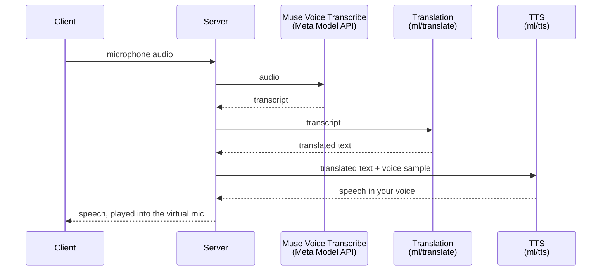
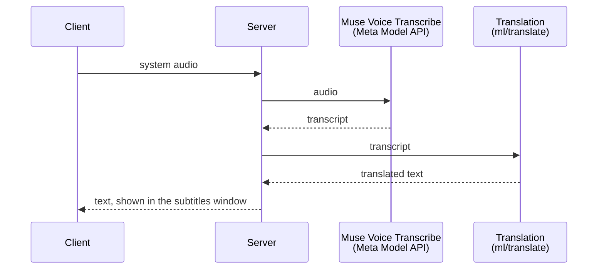

# Sintem Voice

Live speech translation for calls on macOS. You speak your language, and
the other side hears you in theirs, in your own voice, through a virtual
microphone that works with Zoom, Meet, Discord or any other app. What
they say comes back as live subtitles over the screen.

Built for the Meta Global AI Developer Hackathon, track "Build for Your
World".

## Demo

<!-- Demo video link -->

## Features

- **Voice translation.** Your speech is transcribed, translated and
  spoken in your cloned voice on the `Sintem Voice (Virtual Mic)`
  microphone. Pick it
  as the microphone in any call app.
- **Live subtitles.** System audio (the other people on the call) is
  transcribed and translated into a floating subtitles window.
- **Voice cloning.** A short sample of your voice is enough for the TTS
  to speak the translation in it.
- **Simultaneous translation.** Translation starts while you are still
  speaking: every new word is translated right away and stable parts are
  voiced without waiting for the end of the sentence.
- **Languages:** English, Russian, Spanish, German, French (beta).

## How it works

The system has four parts, each can run on its own machine:

- **Client** (Electron, macOS) captures audio and plays the result.
- **Server** (NestJS) holds the session and calls the models in order.
  The client talks only to the server.
- **Muse Voice Transcribe** runs in the Meta Model API, the server
  streams audio to it over the realtime ASR WebSocket.
- **Translation** ([`ml/translate`](ml/translate/README.md), llama.cpp)
  and **TTS** ([`ml/tts`](ml/tts/README.md), VoxCPM2) are our own GPU
  services. The server streams text to translation over HTTP and to TTS
  over a WebSocket.

**Voice translation** (`/translate-voice`): what you say, the others hear
in their language, in your voice.

**Subtitles** (`/translate-subtitles`): what the others say, you read in
your language.

All steps are streamed: the next one starts on partial results of the
previous one, not after the whole sentence.

1. The client streams 16 kHz PCM from the microphone or system audio to
   the server.
2. The server forwards it to **Muse Voice Transcribe**
   (`muse-voice-transcribe-1.0`) over the Meta realtime ASR WebSocket and
   receives partial and final transcripts.
3. The stable part of the transcript is translated word by word, earlier
   drafts are replaced as the sentence grows.
4. For voice translation, finished parts go to the TTS service, which
   speaks them in the user's voice and keeps the flow of the earlier
   speech. The audio is streamed back to the client and played into the
   virtual microphone.

### Use of Meta models

| Model                   | Where                                                                                     | What for                         |
| ----------------------- | ----------------------------------------------------------------------------------------- | -------------------------------- |
| Muse Voice Transcribe   | [`meta-transcribe.service.ts`](server/src/transcription/meta-transcribe.service.ts)       | Realtime speech recognition for both voice translation and subtitles |

Muse Voice Transcribe is the start of every pipeline, and the whole
product is built around its realtime mode:

- **Streaming, not files.** The server opens the realtime ASR WebSocket
  (`muse-voice-transcribe-1.0`) for each session and streams 16 kHz PCM
  to it while the person is still speaking.
- **Cumulative partials drive simultaneous translation.** With
  `partialMode: CUMULATIVE` every partial carries the whole phrase so far.
  [`StableTranscript`](server/src/transcription/stable-transcript.ts)
  takes only the newly added words, and each of them goes to translation
  right away, so the translation and the voice start before the phrase
  ends.
- **Endpointing closes the phrase.** In `ENDPOINTING` mode the model
  detects the pause after a phrase (`speechComplete`). The whole phrase
  is final by then, so the translator finishes it and waits for the next
  `speechStart` instead of translating silence.
- **Language bias.** The language the user picked is passed as
  `languageBias`, which keeps short phrases and the first words of a
  phrase from being recognized as a similar language.

## Project structure

| Path                                   | What                                                  |
| -------------------------------------- | ----------------------------------------------------- |
| [`client/`](client/README.md)          | Electron + React app, subtitles window, settings      |
| [`client/virtual-mic/`](client/virtual-mic/README.md) | CoreAudio driver for the virtual microphone |
| [`server/`](server/README.md)          | NestJS backend: ASR, translation, TTS pipelines       |
| [`ml/translate/`](ml/translate/README.md) | Translation service on llama.cpp                   |
| [`ml/tts/`](ml/tts/README.md)          | TTS service with voice cloning on VoxCPM2             |

## Running

Start the parts in this order. Each can run on its own machine.

1. ML services (Linux with an NVIDIA GPU):
   - [Translation](ml/translate/README.md), port 8100
   - [TTS](ml/tts/README.md), port 8200
2. [Server](server/README.md), port 3000. Needs a Meta Model API key in
   `META_API_KEY`. Point it at the ML services with `TRANSLATE_URL` and
   `TTS_URL`.
3. [Client](client/README.md) (macOS). Set the server address with
   `BACKEND_URL`.

## Built during the hackathon

All code in this repository was written during the hackathon building
period (from October 27, 2026), starting from the first commit; the git
history shows the whole process.

Third-party parts it builds on:

- [`client/virtual-mic/`](client/virtual-mic/README.md) is based on
  Apple's sample "Creating an Audio Server Driver Plug-in".
- [llama.cpp](https://github.com/ggml-org/llama.cpp) runs the translation
  model, a fine-tuned GGUF pinned in
  [`ml/translate/start.sh`](ml/translate/start.sh).
- [VoxCPM2](https://github.com/OpenBMB/VoxCPM) with the
  [nano-vllm](https://github.com/a710128/nanovllm-voxcpm) engine runs TTS.
